<div align="center">

# 🎸 Banda Livert — Official Web Platform

**"Som de Tubarão para o mundo!"**  
*High-performance, responsive web platform engineered for Banda Livert (Rock, Pop & Flashback).*

[](https://mauricio-g-oliveira.github.io/banda-livert/)
[](https://react.dev/)
[](https://tailwindcss.com/)
[](https://vitejs.dev/)
[](LICENSE)

<br />

[Explore Live Demo](https://mauricio-g-oliveira.github.io/banda-livert/) • [Architecture](#-architecture--design-system) • [Branching Strategy](#-branching-strategy--git-workflow) • [Getting Started](#-getting-started)

---

</div>

## 📌 Overview

This project is the official web application for **Banda Livert**, a premier classic rock, pop, and flashback band based in **Tubarão, Santa Catarina, Brazil**. 

Engineered with modern frontend best practices, it serves as both a public-facing showcase for fans and a high-converting event booking engine for concert halls, private weddings, corporate venues, and festivals.

### 🌟 Key Highlights
* **Zero-Bloat Performance:** Built on Vite with ESM bundling for near-instant cold starts and sub-second production builds.
* **Rock Aesthetic UI:** Tailored dark-mode palette featuring metallic specular highlights, subtle stage glows, and glassmorphic navigation.
* **Lead Generation Engine:** Direct WhatsApp routing with pre-formatted message payloads tailored to client inquiry types.
* **100% Responsive & Accessible:** Designed mobile-first across standard handheld, tablet, and ultra-wide desktop viewports.

---

## 🏛️ Architecture & Component Hierarchy

The application follows a clean modular component architecture separating domain data, presentational UI components, and interactive modal viewports.

```mermaid
graph TD
    App[App.jsx - Root Viewport]
    
    subgraph Core Structure
        Navbar[Navbar.jsx - Glassmorphic Header]
        Hero[Hero.jsx - Stage Visuals & Call to Action]
        NextShow[NextShowBanner.jsx - Live Tour Ticker]
        Grid[FeatureGrid.jsx - 6-Card Dashboard Matrix]
        About[AboutSection.jsx - Band History & PDF Press Kit]
        Members[MembersSection.jsx - 5 Individual Musician Cards]
        Repertoire[RepertoireSection.jsx - Musical Genres & Event Types]
        Schedule[ScheduleSection.jsx - Tour Calendar & Filter Engine]
        Gallery[GallerySection.jsx - Concert Lightbox Grid]
        Contact[ContactBookingSection.jsx - Direct WhatsApp Form]
        Footer[Footer.jsx - Credits & Navigation]
    end

    subgraph Modals & Overlays
        MemberModal[MemberModal.jsx - In-depth Biography]
        VideoModal[VideoModal.jsx - Stage Performance Preview]
        Lightbox[Gallery Lightbox - Fullscreen Photo Viewer]
        FloatingCTA[Floating WhatsApp Button]
    end

    App --> Navbar
    App --> Hero
    App --> NextShow
    App --> Grid
    App --> About
    App --> Members
    App --> Repertoire
    App --> Schedule
    App --> Gallery
    App --> Contact
    App --> Footer

    Members --> MemberModal
    Grid --> VideoModal
    Gallery --> Lightbox
    App --> FloatingCTA
```



---

## 🌳 Branching Strategy & Git Workflow

This repository adheres to a disciplined **Git Flow** pattern suited for production environments and team collaboration:

| Branch | Purpose | Protection / Merging |
| :--- | :--- | :--- |
| **`main`** | Production-ready stable release code. | Protected. Releases tagged via SemVer (`v1.0.0`). |
| **`develop`** | Active integration branch for upcoming releases. | Primary branch for Pull Requests. |
| **`feat/*`** | Feature-specific development branches. | Created from `develop`, merged via Pull Request. |
| **`fix/*`** | Bug remediation branches. | Merged into `develop`. |
| **`gh-pages`** | Automated production distribution branch for GitHub Pages. | Updated automatically via build scripts. |

### Commit Guidelines
All commits adhere to the **Conventional Commits** standard:
* `feat:` New user-facing functionality
* `fix:` Defect correction
* `docs:` Documentation improvements
* `style:` UI cosmetics or formatting
* `refactor:` Code reorganization without behavioral change
* `chore:` Build configuration or tooling maintenance

---

## 📁 Project Structure

```
banda-livert/
├── .github/
│   ├── ISSUE_TEMPLATE/
│   │   ├── bug_report.md
│   │   └── feature_request.md
│   └── PULL_REQUEST_TEMPLATE.md
├── public/
│   ├── images/
│   │   ├── gallery/          # High-resolution live concert photography
│   │   ├── members/          # Cropped portraits for all 5 musicians
│   │   ├── agenda-poster.jpeg
│   │   ├── band-cutout.jpeg
│   │   └── logo.jpeg
│   └── presskit-banda-livert.pdf # Downloadable official press kit
├── src/
│   ├── components/
│   │   ├── AboutSection.jsx
│   │   ├── ContactBookingSection.jsx
│   │   ├── FeatureGrid.jsx
│   │   ├── Footer.jsx
│   │   ├── GallerySection.jsx
│   │   ├── Hero.jsx
│   │   ├── MemberModal.jsx
│   │   ├── MembersSection.jsx
│   │   ├── Navbar.jsx
│   │   ├── NextShowBanner.jsx
│   │   ├── RepertoireSection.jsx
│   │   ├── ScheduleSection.jsx
│   │   └── VideoModal.jsx
│   ├── data/
│   │   └── bandData.js       # Centralized domain data model
│   ├── App.jsx               # Main application container
│   ├── index.css             # Tailwind base, utilities & rock tokens
│   └── main.jsx              # React DOM entry point
├── .editorconfig
├── .gitignore
├── CONTRIBUTING.md
├── index.html
├── LICENSE
├── package.json
├── postcss.config.js
├── tailwind.config.js
└── vite.config.js
```

---

## 💻 Tech Stack & Engineering Decisions

| Technology | Purpose | Rationale |
| :--- | :--- | :--- |
| **React 18** | UI Layer | Component reusability, declarative DOM manipulation, fast reconciliation. |
| **Tailwind CSS 3** | Styling & Theme | Utility-first CSS eliminates bloated style sheets and ensures token consistency. |
| **Vite 5** | Bundler & Dev Server | Lightning-fast HMR and optimized Rollup chunk generation for static deployments. |
| **Lucide Icons** | SVG Iconography | Scalable, accessible, lightweight vector icons with zero runtime overhead. |
| **GitHub Pages** | Hosting | Zero-cost, high-availability CDN edge distribution with HTTPS enforcement. |

---

## 🚀 Getting Started

### Prerequisites
* **Node.js**: v18.0.0 or higher
* **npm**: v9.0.0 or higher

### Local Installation
```bash
# Clone the repository
git clone https://github.com/Mauricio-G-Oliveira/banda-livert.git

# Navigate into project directory
cd banda-livert

# Install dependencies
npm install

# Start local development server
npm run dev
```

The application will be served at `http://localhost:5173/`.

### Production Build
```bash
# Compile and bundle assets for production
npm run build

# Preview production build locally
npm run preview
```

---

## 👤 Author & Maintainer

**Mauricio Goulart de Oliveira**  
*Full Stack Developer & Bassist for Banda Livert*  
* 🐙 **GitHub:** [@Mauricio-G-Oliveira](https://github.com/Mauricio-G-Oliveira)
* 🎸 **Band Instagram:** [@bandalivert](https://www.instagram.com/bandalivert)
* 📱 **WhatsApp Booking:** [+55 (48) 99966-8821](https://wa.me/5548999668821)

---

## 📄 License

This project is licensed under the **MIT License** — see the [LICENSE](LICENSE) file for details.
